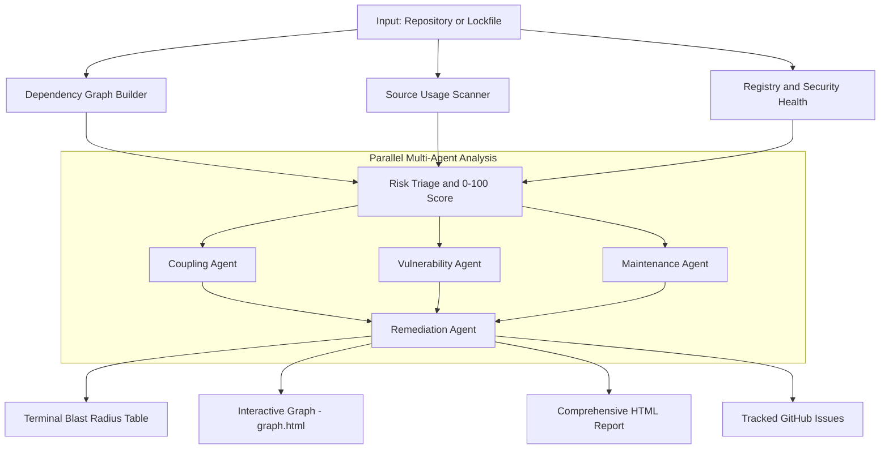

<div align="center">

# ATLAS
### Dependency Mapper & Multi-Agent Risk Analyzer

[](https://go.dev/)
[](https://ollama.com)

#### Included In 
[](https://github.com/xerj-org/xerj)[](https://hub.xerj.org/corpus/ghostuf--atlas)

**Srijan Dahal · Parth Poudyal · Arun Mainali · Suprit Phuyal** · *Frogtober Fest 2026*

</div>

---

Atlas answers the question `npm audit` never could: *how deeply is my codebase wired into this dependency, and what happens to me specifically if it breaks or gets abandoned?*

It maps blast radius, maintainer health, and vulnerability reachability across your full dependency graph, then dispatches a team of parallel AI agents to produce concrete, prioritized remediation plans.

Demo Video: <a href="https://youtu.be/Sz50TpRbgHI">Atlas Demo Video - FrogtoberFest 2026 </a>
## Use Cases

**Nepal:** Government websites here leak data on a near-routine basis. We believe this is largely a result of bad engineering, not sophisticated attacks: unaudited dependencies and unoptimized codebases shipped without anyone checking what's actually in the dependency tree or whether it's being used safely. Atlas is built to catch exactly that, before it becomes the next breach.

**Global:** Packages will never stop breaking. As technology advances, so do the ways to break it. Atlas keeps that in check: it flags what's risky to keep using, what to avoid adding, and how the codebase itself can be further optimized, for example, by flagging unused dependencies that are just clutter waiting to be removed.

## How It Works



## Prerequisites

| | |
|---|---|
| **Go 1.22+** | Build & run |
| **Ollama** | `ollama pull gemma4:e4b` |
| **GitHub Token** | Required. Classic token, with `repo` scope if you want to open issues in private repositories |

## Setup

```bash
git clone https://github.com/your-org/atlas.git
cd atlas
cp .env.example .env   # add your GITHUB_TOKEN
```

`.env`:
```env
GITHUB_TOKEN=ghp_your_token_here
OLLAMA_HOST=http://localhost:11434
```

## Quick Start

```bash
# Interactive agent, no repo loaded yet
go run .

# Interactive agent, pre-loaded with a repo
go run . -repo cloudflare/mcp
```

## How to Run

Atlas is a conversational REPL. Run it with no flags and tell it what to analyze, or pass `-repo` to pre-load a repo as your first message. The agent orchestrates the pipeline via tool calls, produces an HTML report, and can file GitHub issues on your behalf.

## Key Flags

| Flag | Description |
|---|---|
| `-repo owner/name` | GitHub repo to analyze; pre-loads it as the first message |
| `-ref branch/sha` | Git ref (default: repo default branch) |
| `-dir subpath` | Subdirectory for monorepos |
| `-model name` | Ollama model (default: `gemma4:e4b`) |

## Debug

Bypasses the agent entirely and runs the deterministic pipeline once, printing straight to the terminal. Useful for local debugging, **not the intended way to use Atlas**.

| Flag | Description |
|---|---|
| `-file ./lockfile` | Local `package-lock.json` or `poetry.lock`; triggers this mode |
| `-top N` | Rows to print (default: 25) |
| `-src dir` | Local source dir to scan for usage (default: dir of `-file`) |
| `-show pkg` | Print sampled usage snippets for a package |
| `-viz path` | Write an interactive HTML graph, e.g. `graph.html` |
| `-viz-max N` | Max nodes in the visualization (default: 150) |
| `-health=false` | Skip dependency health checks |
| `-health-top N` | Also health-check this many extra packages by blast radius |
| `-health-json path` | Write the health report as JSON |
| `-cpuprofile path` / `-memprofile path` / `-trace path` | Go profiling output |

## Outputs

- **Terminal**: ranked blast-radius table + health summary per package
- **`graph.html`**: interactive D3 force-directed visualization (node size = blast radius)
- **`reports/report.html`**: full HTML report with multi-agent risk profiles, opened automatically in browser
- **GitHub issues**: Atlas can open issues directly on the analyzed repository, if your `GITHUB_TOKEN` has write access to it

## Ecosystem Support

| Ecosystem | Lockfile |
|---|---|
| npm | `package-lock.json` (v1/v2/v3) |
| Python/Poetry | `poetry.lock` |

Detection is automatic. Adding a new package manager requires only implementing the `EcosystemAdapter` interface, with zero changes to core.

## AI Usage Disclosure

Atlas uses a locally-hosted Ollama model whose output is consumed programmatically; deserialized into Go structs that drive reports and GitHub issue creation. Every AI-consuming function includes a deterministic fallback; raw model text is never passed through as structured data. For a full, file-by-file breakdown of every programmatic consumption point, see [AIUSAGE.md](AIUSAGE.md).

## Limitations / Future Improvements

Atlas is under active development. The current limitations are areas where open-source contributors can make the most impact:

| Limitation | Detail | Opportunity |
|---|---|---|
| **Ecosystem coverage** | Backend support is currently limited to **npm** (`package-lock.json` v1/v2/v3) and **Python/Poetry** (`poetry.lock`). Other major ecosystems: Cargo (Rust), Go Modules, Composer (PHP), Maven/Gradle (Java), Bundler (Ruby), uv/Pipenv (Python), are not yet supported. | Adding a new ecosystem requires only implementing the `EcosystemAdapter` interface with zero changes to core logic. See the [Ecosystem Adapters](CONTRIBUTING.md#a-ecosystem-adapters-coreadaptergo-coreecosystemgo-corelang) section of CONTRIBUTING.md for a step-by-step guide. |
| **Agent coverage** | No specialist agents yet exist for license compliance, supply-chain/typosquatting detection, or dependency bloat analysis. | New agents plug into the existing parallel dispatch pipeline. Contribution ideas and architectural guidance are detailed in the [Multi-Agent Reasoning](CONTRIBUTING.md#b-multi-agent-reasoning--specialists-agents) section of CONTRIBUTING.md. |
| **Output formats** | Atlas currently outputs terminal tables, an interactive HTML graph, and a self-contained HTML report. Standards like SARIF, CycloneDX/SPDX SBOM, and structured JSON are not yet supported. | Export format work is scoped in the [CLI & Developer Experience](CONTRIBUTING.md#e-cli-repl--developer-experience-maingo-agentsorchestratorgo) section of CONTRIBUTING.md. |
| **CI/CD integration** | There is no first-party GitHub Actions workflow or CI pipeline integration. | Community-contributing workflows would enable Atlas to enforce dependency health budgets on every pull request. |

We view each limitation as an invitation. Atlas is designed with modular seams specifically so that contributors can work independently on isolated layers. If any of the above interests you, check out [CONTRIBUTING.md](CONTRIBUTING.md) for detailed guidelines, architecture seams, and our pull request schematics.

## Contributing

We welcome open-source contributions! Whether you want to add new ecosystem adapters (Cargo, Go modules, Composer), build new specialist agents, or enhance the interactive visualizer, please check out [CONTRIBUTING.md](CONTRIBUTING.md) for detailed guidelines, architecture seams, and our pull request schematics.

---

<div align="center">

Built for **Frogtober Fest 2026** · Runs entirely on your machine · No data sent to any external AI service

</div>
