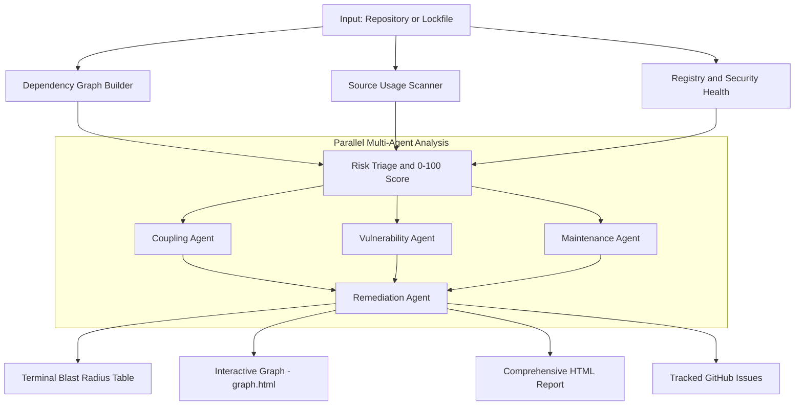

<div align="center">

# ATLAS
### Dependency Mapper & Multi-Agent Risk Analyzer

[](https://go.dev/)
[](https://ollama.com)

**Srijan Dahal · Parth Poudyal · Arun Mainali · Suprit Phuyal** · *Frogtober Fest 2026*

</div>

---

Atlas answers the question `npm audit` never could: *how deeply is my codebase wired into this dependency, and what happens to me specifically if it breaks or gets abandoned?*

It maps blast radius, maintainer health, and vulnerability reachability across your full dependency graph, then dispatches a team of parallel AI agents to produce concrete, prioritized remediation plans.

## How It Works



## Prerequisites

| | |
|---|---|
| **Go 1.22+** | Build & run |
| **Ollama** | Required for interactive mode only — `ollama pull gemma4:e4b` |
| **GitHub Token** | Optional for one-shot mode; required for interactive mode |

## Setup

```bash
git clone https://github.com/your-org/atlas.git
cd atlas
cp .env.example .env   # add your GITHUB_TOKEN
```

`.env`:
```env
GITHUB_TOKEN=ghp_your_token_here
OLLAMA_HOST=http://localhost:11434
```

## Quick Start

```bash
# One-shot: analyze a public repo (no Ollama needed)
go run . -repo  cloudflare/mcp

# One-shot: analyze a local lockfile
go run . -file ./package-lock.json

# Interactive AI agent (requires Ollama + GitHub token)
go run .
```

## Two Modes

- **One-shot CLI** — pass `-repo` or `-file` and Atlas runs the full pipeline and exits. Fast, deterministic, no LLM required.
- **Interactive Agent** — run with no flags to get a conversational REPL. The agent orchestrates the pipeline via tool calls, produces an HTML report, and can file GitHub issues on your behalf.

### Scope & Limitations

| Feature / Consideration | One-Shot CLI (`-repo` / `-file`) | Interactive Agent (`go run .`) |
|---|---|---|
| **Ideal For** | Fast CI/terminal checks & quick graph/health audits | Deep architectural triage & automated remediation |
| **Prerequisites** | Go only (zero LLM; token optional) | Ollama running (`gemma4:e4b`) + `GITHUB_TOKEN` |
| **AI Specialists & Remediation** | ❌ Skipped (purely deterministic) | ✅ 4 parallel agents (Coupling, Vuln, Maintenance, Remediation) |
| **Full HTML Audit Report** | ❌ (stdout terminal summary only) | ✅ Generated & automatically opened in browser |
| **Interactive Graph (`graph.html`)** | Opt-in with `-viz graph.html` | ✅ Automatically created & opened in browser |
| **GitHub Issue Filing** | ❌ Not available | ✅ Triages, deduplicates, and files issues upon confirmation |
| **Local File Constraints (`-file`)** | Requires sibling manifest (`package.json` for v1, `pyproject.toml` for poetry); source scan defaults to lockfile folder (pass `-src` if separate) | Can analyze local lockfiles via chat prompt, but cannot file GitHub issues without an explicit remote repo |

## Key Flags

| Flag | Description |
|---|---|
| `-repo owner/name` | GitHub repo to analyze |
| `-file ./lockfile` | Local `package-lock.json` or `poetry.lock` |
| `-ref branch/sha` | Git ref (default: repo default branch) |
| `-dir subpath` | Subdirectory for monorepos |
| `-viz graph.html` | Write interactive HTML dependency graph |
| `-health=false` | Skip health checks for a fast graph-only run |
| `-health-top N` | Also health-check top N transitive deps |
| `-show pkg` | Print usage snippets for a specific package |
| `-model name` | Ollama model (default: `gemma4:e4b`) |

## Outputs

- **Terminal** — ranked blast-radius table + health summary per package
- **`graph.html`** — interactive D3 force-directed visualization (node size = blast radius)
- **`reports/report.html`** — full HTML report with multi-agent risk profiles, opened automatically in browser

## Ecosystem Support

| Ecosystem | Lockfile |
|---|---|
| npm | `package-lock.json` (v1/v2/v3) |
| Python/Poetry | `poetry.lock` |

Detection is automatic. Adding a new package manager requires only implementing the `EcosystemAdapter` interface — zero changes to core.

---

<div align="center">

Built for **Frogtober Fest 2026** · Runs entirely on your machine · No data sent to any external AI service

</div>
