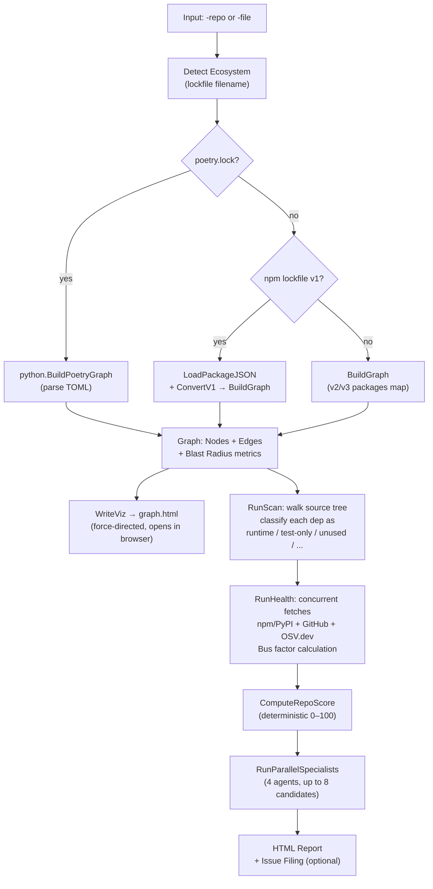
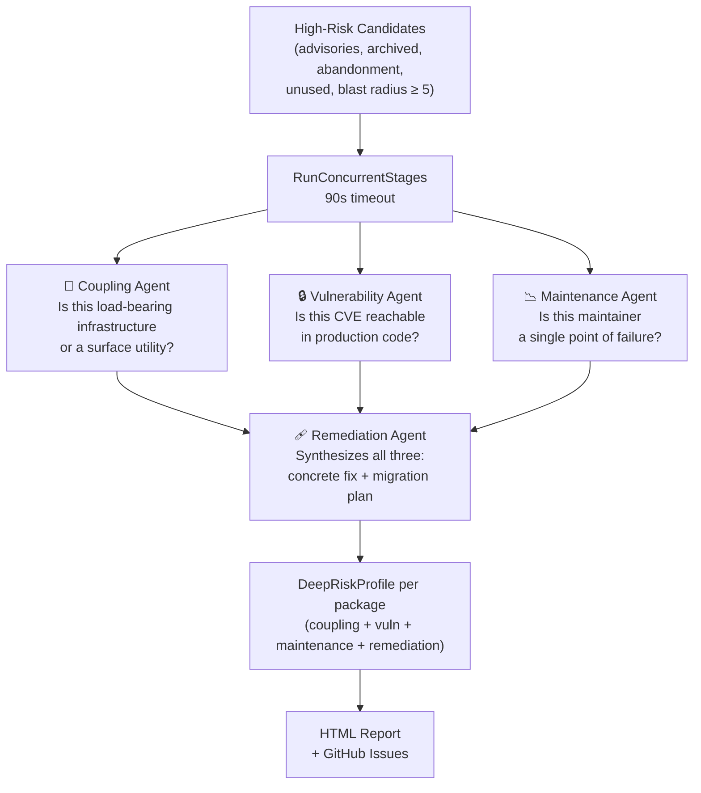
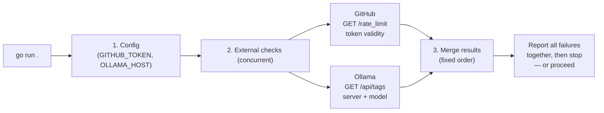

<div align="center">

# ATLAS
### Dependency Mapper & Multi-Agent Risk Analyzer

[](https://go.dev/)
[](LICENSE)
[](https://ollama.com)

**Srijan Dahal · Parth Poudyal · Arun Mainali · Suprit Phuyal**  
*Frogtober Fest 2026*

</div>

---

> **Atlas answers the question `npm audit` never could:**  
> *"How deeply is my codebase wired into this dependency — and what happens to me specifically if it breaks, gets abandoned, or has a vulnerability I don't actually reach?"*

Most security tools tell you a package has a known CVE. Atlas tells you whether that CVE matters **in your project** — because a critical advisory in a test-only package is fundamentally different from one in the middleware your entire request pipeline depends on. It maps architectural coupling, blast radius, maintainer health, and vulnerability reachability across your full dependency graph, and dispatches a team of parallel AI agents to produce concrete, prioritized remediation plans.

---

## Table of Contents

- [How It Works](#how-it-works)
- [Features](#features)
- [Prerequisites](#prerequisites)
- [Installation](#installation)
- [Quick Start](#quick-start)
- [Usage](#usage)
  - [One-Shot CLI Mode](#one-shot-cli-mode)
  - [Interactive Agent Mode](#interactive-agent-mode)
  - [All Flags](#all-flags)
- [Architecture](#architecture)
  - [Project Layout](#project-layout)
  - [The Analysis Pipeline](#the-analysis-pipeline)
  - [Multi-Agent System](#multi-agent-system)
  - [Parallel Execution](#parallel-execution)
- [Outputs](#outputs)
- [Startup Validation & Errors](#startup-validation--errors)
- [Ecosystem Support](#ecosystem-support)
- [Environment Variables](#environment-variables)

---

## How It Works

Atlas runs in two phases — a deterministic data pipeline and an AI reasoning layer — and combines them into a single report.

```
┌─────────────────────────────────────────────────────────────────┐
│                        ATLAS PIPELINE                           │
│                                                                 │
│  Lockfile ──► Graph Build ──► Usage Scan ──► Health Fetch       │
│   (npm/poetry)  (blast radius)  (JS/Python)  (npm+GitHub+OSV)  │
│                                     │                           │
│                              ┌──────▼──────┐                    │
│                              │  Risk Triage│                    │
│                              └──────┬──────┘                    │
│                                     │ parallel                  │
│              ┌──────────────────────┼──────────────────────┐    │
│              ▼                      ▼                      ▼    │
│       Coupling Agent      Vulnerability Agent    Maintenance     │
│      (load-bearing vs     (contextual severity   Agent          │
│       surface utility)    by usage context)    (bus factor +    │
│                                                 abandonment)    │
│              └──────────────────────┬──────────────────────┘    │
│                                     ▼                           │
│                           Remediation Agent                     │
│                      (concrete fix + migration plan)            │
│                                     │                           │
│                    ┌────────────────▼──────────────────┐        │
│                    │  HTML Report + Interactive Graph   │        │
│                    │  (+ optional GitHub Issue Filing)  │        │
│                    └───────────────────────────────────┘        │
└─────────────────────────────────────────────────────────────────┘
```

---

## Features

| Feature | Description |
|---|---|
| **Blast Radius Ranking** | Every dependency is ranked by how many packages transitively depend on it — the true measure of structural risk |
| **Usage Classification** | Static source scan categorizes every dependency as `runtime`, `test-only`, `config-referenced`, `build-tooling`, or `unused-candidate` |
| **Contextual Vulnerability Severity** | Re-weights OSV/CVE advisories against real usage — a critical advisory in test code is downgraded, a moderate advisory in core infrastructure is elevated |
| **Maintainer Abandonment Detection** | Measures bus factor alongside contributor count and weekly downloads — a 90% bus factor on a 500k-download package is different from one on a 200-download package |
| **Parallel AI Specialist Agents** | Four specialist agents run concurrently on high-risk candidates: coupling depth, vulnerability exploitability, maintenance sustainability, and concrete remediation |
| **Interactive Dependency Graph** | Force-directed HTML visualization with node sizing by blast radius, hover tooltips, search, and filter |
| **0–100 Health Score** | Deterministic, auditable score computed from advisory severity, abandonment signals, archived repos, and unused bloat |
| **GitHub Issue Filing** | Triages findings into structured GitHub issues with deduplication via fingerprints — never files the same issue twice |
| **npm + Python/Poetry Support** | Adapter-based ecosystem architecture; adding a new package manager requires zero changes to core |
| **Heuristic Fallbacks** | Every AI agent works without Ollama — deterministic heuristics ensure the system never fails due to an LLM error |

---

## Prerequisites

| Requirement | Version | Purpose |
|---|---|---|
| **Go** | 1.22+ | Build and run Atlas |
| **Git** | Any modern | Cloning repositories for analysis |
| **Ollama** | Any | Local LLM for interactive agent mode |
| **GitHub Token** | — | Health checks (optional, raises rate limits); required for interactive mode |

### Setting Up Ollama

Atlas uses a locally-running Ollama model. The default is `gemma4:e4b`.

```bash
# Install Ollama (https://ollama.com)
# Then pull the default model:
ollama pull gemma4:e4b

# Or use any other model:
ollama pull qwen2.5:7b
```

> **Note:** Ollama is only needed for **interactive agent mode** (`go run .`). One-shot CLI mode (`-repo` or `-file`) does not use it.

---

## Installation

```bash
# Clone the repository
git clone https://github.com/your-org/atlas.git
cd atlas

# Copy and configure environment variables
cp .env.example .env
# Edit .env and add your GITHUB_TOKEN

# Build the binary (optional)
go build -o atlas .

# Or run directly with go run
go run . --help
```

### Environment Setup

Create a `.env` file (or export variables in your shell):

```env
GITHUB_TOKEN=ghp_your_token_here
OLLAMA_HOST=http://localhost:11434   # optional, this is the default
```

---

## Quick Start

```bash
# Analyze a public GitHub repository (one-shot, no Ollama needed)
go run . -repo expressjs/express

# Analyze a local npm lockfile
go run . -file ./package-lock.json

# Analyze a Python/Poetry project
go run . -file ./poetry.lock

# Launch the interactive AI agent (requires Ollama + GitHub token)
go run .
```

The first time you run it, Atlas will ask for a `GITHUB_TOKEN` if one is not set.

---

## Usage

Atlas has two modes: a fast one-shot CLI and a full conversational AI agent.

### One-Shot CLI Mode

Provide a `-repo` or `-file` flag and Atlas runs the entire analysis pipeline and exits.

```bash
# Analyze a GitHub repository
go run . -repo cloudflare/mcp

# Specify a branch or commit
go run . -repo cloudflare/mcp -ref main

# Monorepo: analyze a subdirectory's lockfile
go run . -repo owner/monorepo -dir packages/app

# Local lockfile with interactive visualization
go run . -file ./package-lock.json -viz graph.html

# Show where a specific package is used
go run . -repo owner/repo -show lodash

# Extend health checks to transitive dependencies
go run . -repo owner/repo -health-top 20

# Save health data as JSON
go run . -repo owner/repo -health-json health.json

# Disable health checks for a fast graph-only run
go run . -repo owner/repo -health=false

# Run unit tests
go test -v ./...
```

#### Example Output

```
Graph: 312 vertices, 891 edges, 28 direct deps

PACKAGE                                  VERSION    DIRECT  DEPTH  DEPENDENTS  TRANSITIVE
ms                                       2.1.3      false   2      24           301
debug                                    4.3.4      false   2      18           278
safe-buffer                              5.2.1      false   3      14           201
...

Overall dependency health score: 72/100 (Fair).

PACKAGE        VERSION  CLASS        WEEKLY DL   BUS FACTOR  ADVISORIES
ms             2.1.3    runtime      1.2B        12%         0
debug          4.3.4    runtime      800M        18%         0
lodash         4.17.21  runtime      290M        31%         2 (HIGH)
...

[Multi-Agent Risk Analysis]
• Package: lodash@4.17.21 (Blast Radius: 41, Classification: runtime)
  - Architectural Coupling: [HIGH] Core infrastructure — imported across 14 production files
  - Security Vulnerability: Contextual Sev: HIGH, Exploitability: reachable_in_prod, Urgency: immediate
  - Maintainer Health: Abandonment Risk: LOW
  - Recommended Action: Upgrade lodash to 4.17.22 (Effort: trivial)
    Fix: npm install lodash@4.17.22
```

---

### Interactive Agent Mode

Run Atlas with no flags to enter the conversational AI REPL. The agent orchestrates the entire pipeline via tool calls and can file GitHub issues on your behalf.

```bash
go run .
```

```
Atlas — dependency risk analysis agent (model: gemma4:e4b)
Try: "run dependency analysis on cloudflare/mcp". Type "exit" to quit.

you> analyze the dependencies of expressjs/express

[Fetching lockfile...]   ✓
[Analyzing dependencies...] ✓ 312 packages, 891 edges, 28 direct deps
[Creating interactive graph...] ✓ reports/graph.html
[Cloning repository...]  ✓
[Scanning usage...]      ✓ 47 source files — 22/28 direct deps imported
[Checking health (npm, GitHub, OSV.dev)...] ✓ score 72/100 (Fair)
[Running parallel multi-agent analysis across 5 high-risk dependencies...] ✓

atlas> Here's what I found in express's dependency graph...
       [full assessment]

✓ Prepared report: reports/report.html

💡 Atlas found 3 issue(s) worth filing in expressjs/express (1 high, 2 moderate).
   Say the word and I'll draft and create them as GitHub issues.

you> go ahead

[Checking for existing duplicate issues concurrently...] ✓
Atlas identified 3 issue(s) to file:
1. [atlas] HIGH advisory in lodash@4.17.21 (GHSA-xxxx)
2. [atlas] Archived dependency: minimatch@3.0.4
3. [atlas] Abandonment risk: debug@4.3.4 (bus factor 82%)

Target repo: expressjs/express
Shall I go ahead and create these 3 issues? (yes/no)

you> yes

[Creating issue: lodash...]   ✓
[Creating issue: minimatch...] ✓
[Creating issue: debug...]    ✓

Summary: 3 created · 0 skipped · 0 failed
```

---

### All Flags

| Flag | Default | Description |
|---|---|---|
| `-repo owner/name` | — | GitHub repository to analyze |
| `-ref branch/tag/sha` | default branch | Git ref to use |
| `-dir subpath` | root | Subdirectory (monorepos) |
| `-file ./lockfile` | — | Local `package-lock.json` or `poetry.lock` |
| `-top N` | `25` | Rows to show in the ranked table |
| `-src ./dir` | auto-cloned | Local source directory for usage scanning |
| `-show pkg` | — | Print sampled usage snippets for a specific package |
| `-viz graph.html` | — | Write interactive HTML visualization |
| `-viz-max N` | `150` | Max nodes in the visualization |
| `-health` | `true` | Fetch health signals (npm/PyPI, GitHub, OSV.dev) |
| `-health-top N` | `0` | Also check N extra transitive deps by blast radius |
| `-health-json out.json` | — | Save health report as JSON |
| `-model name` | `gemma4:e4b` | Ollama model for interactive agent mode |
| `-cpuprofile file` | — | Write CPU profile (non-agent mode) |
| `-memprofile file` | — | Write heap profile on exit (non-agent mode) |
| `-trace file` | — | Write execution trace (non-agent mode) |

---

## Architecture

### Project Layout

```
Atlas/
├── main.go              # CLI entrypoint and flag parsing
├── agents/              # Multi-agent runtime
│   ├── orchestrator.go  # Master orchestrator + interactive REPL loop
│   ├── coupling.go      # Architectural Coupling Agent
│   ├── vulnerability.go # Vulnerability Risk Agent (contextual severity)
│   ├── maintenance.go   # Maintainer & Abandonment Agent
│   ├── remediation.go   # Remediation Plan Agent
│   ├── action.go        # GitHub Issue Action Agent (draft, dedup, create)
│   ├── pool.go          # Concurrency primitives (limiter, RunParallel)
│   └── types.go         # Shared data types for all agents
├── core/                # Deterministic pipeline — no LLM
│   ├── graph.go         # Dependency graph: parse lockfile, build graph, compute metrics
│   ├── scan.go          # Source-code usage scanner (JS/TS + Python)
│   ├── health.go        # npm/PyPI registry + GitHub + OSV.dev health signals
│   ├── score.go         # Deterministic 0–100 health score
│   ├── report.go        # HTML report generation
│   ├── viz.go           # Interactive D3 force-directed graph
│   ├── ecosystem.go     # Ecosystem abstraction (npm vs poetry)
│   ├── adapter.go       # EcosystemAdapter interface + NpmAdapter
│   ├── ollama.go        # Ollama LLM client (tool-calling + JSON schema)
│   ├── fetch.go         # GitHub lockfile and repository fetching
│   ├── lockv1.go        # npm lockfile v1 → v2 converter
│   ├── preflight.go     # Startup validation
│   ├── errors.go        # Structured error system
│   └── python/          # Python/Poetry ecosystem plug-in
│       └── ...          # (graph builder, scanner, PyPI adapter)
└── examples/            # Sample lockfiles for testing
```

`core/` is a zero-LLM deterministic pipeline. `agents/` is the AI layer on top. `core/python/` is a self-contained plug-in that never requires changes to `core/`.

---

### The Analysis Pipeline



---

### Multi-Agent System

When high-risk candidates are identified, four specialist agents analyze them in parallel, then a fifth synthesizes the results:



#### Agent Decision Logic

**Coupling Agent** — classifies architectural embedding:

| Signal | Result |
|---|---|
| Production files ≥ 8, OR blast radius ≥ 15 | `HIGH` — Load-Bearing Infrastructure |
| Production files ≥ 2, OR blast radius ≥ 5 | `MEDIUM` — Moderate Integration |
| Test files only | `LOW` — Test-Only Utility |
| No evidence | `LOW` — Surface Utility |

**Vulnerability Agent** — re-weights severity by usage context:

| Advisory Severity | Usage Context | Contextual Severity |
|---|---|---|
| `CRITICAL` | Production runtime | `CRITICAL` — immediate |
| `CRITICAL` | Test-only | `HIGH` — next sprint |
| `HIGH` | Test-only | `MODERATE` — backlog |
| Any | Unused/unreachable | `LOW` — monitor |

**Maintenance Agent** — abandonment risk formula:

```
IsAbandonmentRisk = BusFactor ≥ 70%
                    AND ContributorCount ≤ 3
                    AND WeeklyDownloads < 10,000
```

**Remediation Agent** — receives the full picture from all three agents and produces: suggested fix, 1–3 alternative libraries, migration effort (`trivial` / `moderate` / `architectural_refactor`), and the exact CLI command to run.

---

### Parallel Execution

All concurrency in Atlas is bounded by a semaphore-based `ConcurrencyLimiter`. The three specialist analysis stages (Coupling, Vulnerability, Maintenance) run **fully in parallel** via `RunConcurrentStages`. Within each stage, per-candidate LLM calls are themselves parallelized via `RunParallel` (max 3 concurrent Ollama calls per agent type).

```
RunConcurrentStages
├─ goroutine 1 → CouplingAgent.AnalyzeAll(candidates)     ┐
│                  └─ RunParallel(max 3) → ChatOllamaJSON  │ all running
├─ goroutine 2 → VulnerabilityAgent.AnalyzeAll(candidates)│ at the same time
│                  └─ RunParallel(max 3) → ChatOllamaJSON  │
└─ goroutine 3 → MaintenanceAgent.AnalyzeAll(candidates)  ┘
                   └─ RunParallel(max 3) → ChatOllamaJSON

After all three complete:
└─ RemediationAgent.SynthesizeAll(candidates, coupling, vuln, maint)
     └─ RunParallel(max 3) → ChatOllamaJSON
```

Health checks, duplicate detection, and GitHub issue creation are also concurrent — all HTTP calls share a single connection-pooled client to avoid per-request TLS handshake overhead.

---

## Outputs

Atlas generates three types of output:

### 1. Terminal Report
A ranked table of all dependencies by blast radius, followed by a health summary per package. Printed to stdout.

### 2. Interactive Graph (`graph.html`)
A self-contained HTML file with a D3 force-directed visualization.
- **Node size** = blast radius (how many packages depend on it)
- **Node color** = gold (root), mid (direct deps), dark (transitive)
- Hover tooltips, search, and filter controls

Generated with `-viz graph.html` in one-shot mode, or automatically to `reports/graph.html` in agent mode.

### 3. Full HTML Report (`reports/report.html`)
Generated automatically at the end of each agent turn and opened in the browser. Contains:
- Dependency graph summary and ranked table
- Usage scan classification table
- Health signals table with the SVG score gauge
- Multi-agent risk profiles per candidate package
- The model's full written assessment

---

## Startup Validation & Errors

Atlas validates all prerequisites **before doing any work** and checks independent prerequisites concurrently so one failure never hides another.



| Mode | Token | Ollama |
|---|---|---|
| `go run .` (interactive) | Required, validated | Required, model checked |
| `go run . -repo owner/name` | Optional; validated if set | Not used |
| `go run . -file ...` | Validated only if set and `-health` is on | Not used |

When multiple things fail, Atlas reports all of them at once. Errors always include: what failed, what Atlas was trying to do, proven facts vs unverified hypotheses, and concrete next steps. Credentials are redacted from every message.

---

## Ecosystem Support

Atlas uses an `EcosystemAdapter` interface to keep all ecosystem-specific logic behind a clean boundary. The `core/` package never depends on any specific ecosystem subpackage.

| Ecosystem | Lockfile | Registry | Source Scanner |
|---|---|---|---|
| **npm** | `package-lock.json` (v1/v2/v3) | npmjs.com | JS/TS `import`/`require` |
| **Python/Poetry** | `poetry.lock` | PyPI | `import X` / `from X import Y` |

Ecosystem detection is automatic — Atlas tries `poetry.lock` first when fetching from a GitHub repo, then falls back to `package-lock.json`. Adding support for a new package manager (e.g., Cargo, Maven) requires only implementing the `EcosystemAdapter` interface in a new subpackage; no changes to `core/` are needed.

---

## Environment Variables

| Variable | Default | Description |
|---|---|---|
| `GITHUB_TOKEN` | *(none)* | GitHub personal access token. Required for interactive mode. Optional for one-shot mode — setting it avoids GitHub's 60 req/hr unauthenticated rate limit and enables health checks on private repositories. |
| `OLLAMA_HOST` | `http://localhost:11434` | Address of the Ollama server. Only used in interactive agent mode. |

Both variables can be set in a `.env` file at the project root (see `.env.example`) or exported in your shell.

---

<div align="center">

Built for **Frogtober Fest 2026** · Atlas runs entirely on your machine · No data is sent to any external AI service

</div>
